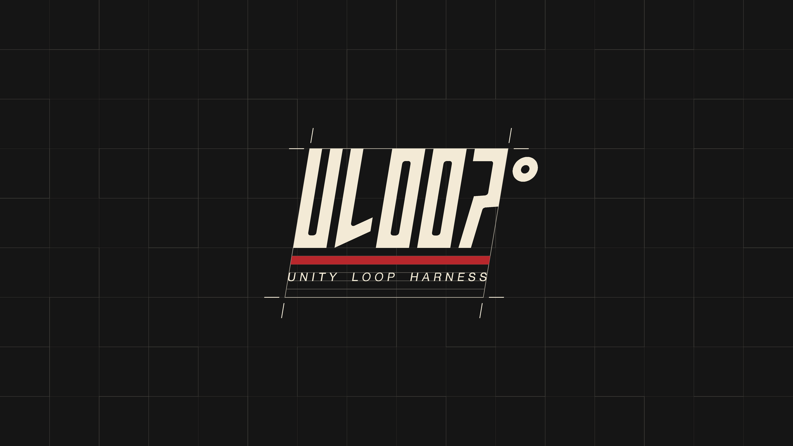
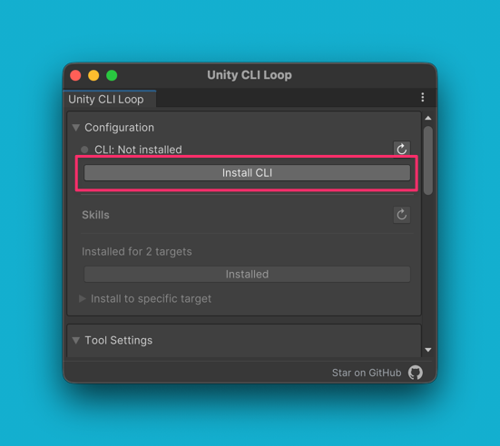
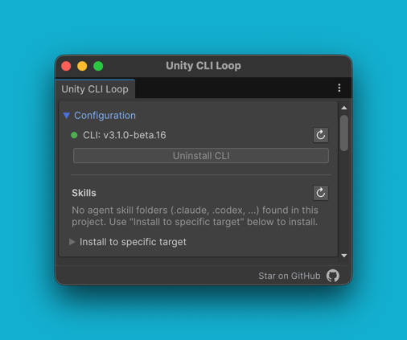
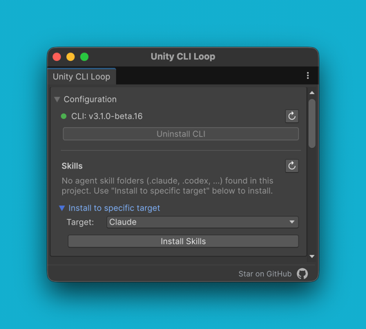

# Unity Loop Harness

[English](README.md) | 日本語

> 旧名は **Unity CLI Loop**、その前は **uLoopMCP** です。`uloop` コマンド、パッケージ ID、インストール手順はそのままです。Editor のメニューは `Window > Unity CLI Loop` から `Window > Unity Loop Harness` に移りました。

[](https://unity3d.com/)
[](LICENSE.md)<br>


![Codex](https://img.shields.io/badge/Codex-111?logo=)


<p align="center">
    
</p>
  

CLIを通じて、AIエージェントがUnityプロジェクトのコンパイル・テスト・操作を各種LLMツールから実行できるようにします。

AI駆動の開発ループを既存のUnityプロジェクト内で自律的に回し続けるために設計されています。

> [!IMPORTANT]
> - **[V3の新機能](Packages/src/Documentation~/whats-new-v3_ja.md)** — Node.jsのセットアップとポート管理の廃止、`hot-reload` / `pause-point` の追加、CLIの自動アップデートとプロジェクトごとの自動バージョン使い分け、接続の安定性の向上
> - **[カスタムツール／スキルのV3移行ガイド](Packages/src/Documentation~/migration-v2-to-v3_ja.md)** — C#カスタムツールや、`uloop` コマンドを呼び出すスキル／スクリプトを自作している方向け。それ以外の方は、パッケージとCLIを更新するだけで移行できます

# コンセプト
Unity Loop Harnessは、「AIがUnityプロジェクトの実装をできるだけ人手を介さずに進められる」ことを目指して作られた Unity連携ツールです。エージェントそのものを動かすのは LLM ツール（Claude Code、Codex、Cursor など）で、Unity Loop Harness はそのハーネスのうち Unity に届く部分です。Editor を操作する手と、結果を確かめる目をエージェントに与えます。
人間が手で行っていたコンパイル、Test Runner の実行、ログ確認、シーン編集、画面キャプチャによるUIレイアウト確認、さらには実装した機能が本当に動くかどうかを実際に操作して確かめる動作確認までを、LLM ツールからまとめて行えるようにします。

Unity Loop Harnessのコアとなるコンセプトは次の3つです。

1. **AIが自律的にビルド・テスト・ログ解析・修正を回し続ける「自律開発ループ」** — コードを書き換えずに任意の行で実行を止め、その瞬間の変数を読み取って原因を特定することもできます。メソッド本体の修正は再コンパイルを待たずに実行中のゲームへ即時反映できます。`compile`, `run-tests`, `get-logs`, `clear-console`, `pause-point`, `hot-reload`
2. **シーン構築、オブジェクト操作、メニュー実行、スクリーンショットからのUI改善など、Unity Editorの操作をAIに委任** — `execute-dynamic-code`, `screenshot`
3. **PlayMode中の自動テスト — ボタンクリック、ドラッグ、キーボード入力、記録済み入力の再生、ゲーム動作の検証をAIが実行** — `simulate-mouse-ui`, `simulate-mouse-input`, `simulate-keyboard`, `replay-input`, `execute-dynamic-code`, `screenshot`

# 公式 Unity CLI と uloop

[公式 Unity CLI](https://docs.unity.com/ja-jp/unity-cli/use-unity-cli)（`unity`）と `uloop` は競合するものではありません。受け持つ作業が違うので、両方を使えます。公式 Unity CLI は、Editor のインストールやプロジェクトの作成からライセンス、CI でのビルドとテストまで、プロジェクトの周りの作業を受け持ちます。`uloop` は、AI エージェントがコードを書きながら開いている Editor の中で回すループのために作られていて、そこでは 公式 Unity CLI より踏み込んでいます。Unity 2022.3 以降で使え、同じ作業でもより細かく指定でき、うまくいかない原因を突き止める道具もそろっています。

## 同じ作業を、より細かく

| やりたいこと | 公式 Unity CLI（`unity`） | Unity Loop Harness（`uloop`） |
|---|---|---|
| 使える Unity のバージョン | Unity 6.0 以降（`com.unity.pipeline` パッケージが必要） | **Unity 2022.3 以降** |
| Editor を再起動する | `unity close` のあと `unity open` | `launch -r`：**1 つのコマンドで再起動し、コマンドを受け付けられるようになるまで待つ** |
| 開いている Editor でテストを実行する | `test run`：名前（部分一致）、アセンブリ、カテゴリで絞り込む | `run-tests`：完全一致の名前、**正規表現**、クラス、アセンブリで絞り込む。**前回失敗したテストだけを再実行**できる。実行前に未保存のシーンの変更を保存するか、止めるか、破棄するかを選べる |
| Console を読む | `console get`：最低の重要度、新しいほうからの件数、カーソルを使った新しいログの追いかけ | `get-logs`：種類で絞り込み、**本文やスタックトレースをテキストや正規表現で検索**できる |
| シーンを読む | `scene get_hierarchy`：シーン全体 | `get-hierarchy`：**指定した GameObject や選択中のオブジェクトを起点にし、深さを制限**できる |
| Editor で C# を実行する | インラインのコードは `script eval`、プロジェクトの `.cs` ファイルを JSON の引数付きで実行するなら `script run` | `execute-dynamic-code`：インラインのコードに JSON のパラメーターを渡せる。**コードが起こしたドメインリロードの完了まで待てる** |
| Play Mode を操作する | `editor.playmode start` / `pause` / `stop` | `control-play-mode`：**1 フレームずつ進める**こともでき、未保存のシーンの変更の扱いも選べる |
| Play Mode でキーを押す | `runtime simulate_key`：押す、離す、押して離す | `simulate-keyboard`：**指定した秒数だけ押し続ける**こともでき、押しっぱなしのキーをまとめて離せる |
| Play Mode でマウスを使う | `runtime simulate_pointer`：指定した位置での移動、押す、離す、クリック | `simulate-mouse-input`：クリック、長押し、**スクロール**、移動量での移動、**クリックせずにその位置に当たる 3D オブジェクトを調べる**。`simulate-mouse-ui`：uGUI と UI Toolkit の要素のクリック、長押し、ドラッグ。**レイキャストを遮る重なりがあっても操作できる** |
| 画面をキャプチャする | `capture`：Game ビューか Scene ビュー。UI Toolkit の要素 1 つだけを撮るのは Unity 6000.7 以降のみ | `screenshot`：Game ビューや**任意の Editor ウィンドウ**（Console、Inspector など）。**クリックできる UI 要素や 3D コライダーに、クリックする座標付きのラベルを付けられる**。**Prefab だけを描画する**こともできる |
| Play Mode を抜けずにコードを変える | あらかじめ `[MethodReload]` を付けたメソッド（public で、`void` か `IEnumerator` を返すもの）。新しく足したメソッドも呼べる。IL2CPP を含む開発ビルドのプレイヤーにも届く | `hot-reload`：**属性は不要**。メソッド本体、新しいメンバー、新しいクラス。Edit Mode でも Play Mode でも使える。コンストラクタなど一部のメンバーはコンパイルが必要。Editor のみ |

## uloop だけにあるもの

| やりたいこと | Unity Loop Harness（`uloop`） |
|---|---|
| コードを書き換えずにソースの行で止めて、変数を読む | `pause-point` |
| Game ビューや任意の Editor ウィンドウを録画し、見る代わりにフレームシートとして読む | `record-video` |
| Play Mode で記録した入力を再生する（記録は Editor の Recordings ウィンドウで行う） | `replay-input` |
| Game ビューの解像度を設定する | `set-game-view-size` |
| Game ビューを Device Simulator で表示し、デバイスを選ぶ | `game-view-mode` |

## 公式 Unity CLI が得意なもの

| やりたいこと | 公式 Unity CLI（`unity`） |
|---|---|
| Unity Editor とモジュールのインストール・管理 | `unity install`、`unity editors`、`unity install-modules` |
| プロジェクトの作成 | `unity projects create` |
| サインインとライセンスの確認 | `unity auth`、`unity license` |
| CI でのプレイヤービルドとテスト | `unity build`、`unity test`（JUnit レポート、シャーディング、リトライ、コードカバレッジ） |
| 起動中のプレイヤービルドを操作する | `unity command --runtime` |

`unity` が付いていないコマンドは `com.unity.pipeline` パッケージの Editor 側のコマンドで、`unity command` で実行します。

よくある使い方は両方を組み合わせる形です。`unity install` と `unity open` で合う版の Editor を用意し、その Editor の中での編集・コンパイル・テスト・ゲームの確認というエージェントのループは `uloop` で回し、CI では `unity build` と `unity test` を使います。

比較の対象は公式 Unity CLI 1.0.0-beta.13 と `com.unity.pipeline` 0.9.1-exp.1（2026 年 11 月時点）です。どちらもプレリリースで変更が速いので、手元の版でできることは `unity --help` と `unity command` で確認してください。

# デモ

どの動画も、Claude Code が `uloop` で小さなボクセルゲームを操作した実際のセッションです。ターミナルだけが動く区間は早送りし、ゲーム画面は実時間で再生しています。

## Unity を起動する：`launch`

`uloop launch` は、プロジェクトが指定するバージョンの Unity でプロジェクトを開き、Editor がコマンドを受け付けられるようになるまで待ちます。

https://github.com/user-attachments/assets/06cb2abf-7d05-49f3-8b0d-afb90417f7f8

## 機能を足してテストする：`compile`、`run-tests`

Claude が光る松明ブロックを追加し、`compile` でビルドして、`run-tests` で EditMode テストを実行します。失敗したテストを直し、Play Mode で夜にして松明を確かめます。

https://github.com/user-attachments/assets/f0daa13b-af3a-4560-9acc-4f6c8262889d

## Play Mode のままコードを変える：`hot-reload`

Claude が二段ジャンプを追加し、Play Mode を止めずに `hot-reload` で反映します。続けて `simulate-keyboard` で Space を押し、ジャンプの高さを測ります。

https://github.com/user-attachments/assets/a1661238-e215-460b-8236-fc5b5707f5e8

## 指定した行で止めて、そのフレームを読む：`pause-point`

水が隙間へ初めて流れ込むとき、セルの新しい水位を決める行で `pause-point` がゲームを止め、そのフレームのローカル変数・フィールド・呼び出し経路を返します。続いてウォッチ式で水路の水位を追いながら、水を 1 tick ずつ進めます。

https://github.com/user-attachments/assets/7d6bbef6-64e7-4d70-af73-676a85f3ad05

## ゲームの中で C# を実行する：`execute-dynamic-code`

`execute-dynamic-code` は実行中のゲームの中で C# を動かします。Claude がプレイヤーの前にガラスブロックを 10 個積み、一時的なカメラから塔全体を撮ります。

https://github.com/user-attachments/assets/ff4ec461-a7bc-4cb5-bcc8-8e1bdfa7fefd

## ゲーム画面を撮る：`screenshot`

Claude が `execute-dynamic-code` で湖を探してカメラを真上に移し、`screenshot` で撮ります。そのあと HUD を隠して撮り直します。

https://github.com/user-attachments/assets/6af6c20d-8ea5-49d9-b913-6e5bc124ff58

## シーンの構造を読む：`get-hierarchy`、`find-game-objects`

`get-hierarchy` が実行中のシーンのツリーをファイルに保存し、`find-game-objects` がプレイヤーのコンポーネントを読みます。

https://github.com/user-attachments/assets/c836df71-d66c-4bf1-8bc4-afc7f69969cb

## キーを押す：`simulate-keyboard`

`simulate-keyboard` が Input System 経由で W キーを押し続けます。プレイヤーは岸から湖に入り、スクリーンショットで水中の視界を確かめます。

https://github.com/user-attachments/assets/cc4e44d5-9a78-49db-99ab-3164a58b472b

## マウスを動かしてクリックする：`simulate-mouse-input`

`simulate-mouse-input` が人の手のようにマウスを少しずつ動かし、ブロックを 3 つ壊して、できた穴を水で満たします。

https://github.com/user-attachments/assets/118c8b4a-8254-4798-a63c-f6a213fc1031

# クイックスタート

このガイドでは、CLI、Unity パッケージ、スキルの 3 つをインストールし、LLM ツールから Unity を操作できる状態にします。ターミナルから入れる方法と Unity の UI から入れる方法があり、どちらか一方で完了します。

## 始める前に

以下を確認してください：

- Unity 2022.3 以降のプロジェクトがある
- Claude Code、Codex など、スキルを読み込める LLM ツールを使っている

> [!NOTE]
> **V2 からアップグレードする場合**: V2 API で作ったカスタムツールがあるプロジェクトでは、V3 パッケージを入れた直後にコンパイルエラーが出ます。これは想定内の挙動です。手で直さず、Unity 起動時の Safe Mode の問い合わせで `Ignore` を選び、自動で開く移行ウィンドウ（`Window > Unity Loop Harness > Custom Tool Migration`）で **Migrate** を押してください。手順は [カスタムツール／スキルの V3 移行ガイド](Packages/src/Documentation~/migration-v2-to-v3_ja.md) を参照してください。

## ターミナルから入れる場合

### ステップ 1：CLI をインストールする

**macOS、Linux (x86_64)、Windows Git Bash:**

Linux では focus-window は未対応です。

```sh
curl -fsSL https://raw.githubusercontent.com/hatayama/unity-cli-loop/main/scripts/install.sh | sh
```

**Windows PowerShell:**

```powershell
irm https://raw.githubusercontent.com/hatayama/unity-cli-loop/main/scripts/install.ps1 | iex
```

**Homebrew（macOS）:**

```bash
brew install hatayama/tap/uloop
```

インストールできたか確認します：

```bash
uloop -v
```

最初の行に CLI のバージョン（例: `3.0.1`）が表示されれば成功です。

### ステップ 2：Unity パッケージをインストールする

Unity プロジェクトのルートで実行します：

```bash
uloop package install
```

OpenUPM の scoped registry と `io.github.hatayama.uloopmcp` の依存を `Packages/manifest.json` に追加します。バージョンを固定するには `--version <x.y.z>` を付けます。

続けて Unity を起動します。Unity がすでに起動している場合は、その Unity にフォーカスします：

```bash
uloop launch
```

Unity が起動すると、パッケージがプロジェクトにインストールされます。次のステップでは、インストールされたパッケージからスキルを読み取ります。

### ステップ 3：スキルをインストールする

使っている LLM ツールに合わせて、Unity プロジェクトのルートで実行します：

```bash
# Claude Code
uloop skills install --claude

# Codex など .agents/skills を読むツール
uloop skills install --agents

# Unity プロジェクトを含む Git リポジトリのルートにインストール
uloop skills install --claude --root git

# プロジェクトではなくグローバルにインストール
uloop skills install --claude --global

# 任意のディレクトリ（外部のスキルパッケージストアなど）へ
uloop skills install --output-dir path/to/skills
```

## Unity の UI から入れる場合

### ステップ 1：Unity パッケージをインストールする

`Window > Package Manager` の「+」から **Add package from git URL** を選び、次の URL を入力します：

```text
https://github.com/hatayama/unity-cli-loop.git?path=/Packages/src
```

<details>
<summary>OpenUPM の scoped registry から入れる場合</summary>

1. `Project Settings > Package Manager` の Scoped Registries に以下を追加します：
```text
Name: OpenUPM
URL: https://package.openupm.com
Scope(s): io.github.hatayama.uloopmcp
```
2. `Window > Package Manager` で My Registries の OpenUPM を選び、Unity Loop Harness（v3.23.1 までは Unity CLI Loop と表示）をインストールします。

</details>

### ステップ 2：CLI をインストールする

`Window > Unity Loop Harness > Settings` を開き、**Install CLI** を押します：



CLI のバージョンが表示され、ボタンが **Uninstall CLI** に変われば完了です：



### ステップ 3：スキルをインストールする

同じ Settings ウィンドウで対象を選び（**Claude Code**、または Codex など `.agents/skills` を読むツール向けの **Common (.agents)**）、**Install Skills** を押します：



<details>
<summary>V2 プロジェクトと併用する場合</summary>

V2 のパッケージを使っているプロジェクトと V3 のプロジェクトは、同じマシンで併用できます。V3 の CLI をインストールしたままにしておけば、V2 のプロジェクトでは `uloop` コマンドが自動的に V2 の CLI を使います（初回に自動でダウンロードされます。Node.js 22 以降が必要です）。

V2 のプロジェクトの Settings ウィンドウで **Update CLI** や **Downgrade CLI** を押したり、V2 の CLI を `npm install -g uloop-cli` で入れ直したりしないでください。古い npm 版の `uloop` が V3 の CLI を隠してしまいます。すでにそうなっている場合は `npm uninstall -g uloop-cli` を実行してから、「ターミナルから入れる場合」のステップ 1 の CLI インストーラをもう一度実行するか、Settings ウィンドウで **Install CLI** を押してください。

</details>

これで完了です！Skillsをインストールすると、LLMツールが以下のような指示に自動で対応できるようになります：

| あなたの指示 | LLMツールが使うSkill |
|---|---|
| 「このプロジェクトのUnityを起動して」 | `/uloop-launch` |
| 「コンパイルエラーを直して」 | `/uloop-compile` |
| 「この修正をコンパイルせずに今すぐ反映して」 | `/uloop-hot-reload` |
| 「テストを実行して失敗原因を教えて」 | `/uloop-run-tests` + `/uloop-get-logs` |
| 「シーンの階層構造を確認して」 | `/uloop-get-hierarchy` |
| 「Unityを再生させて、Unityを前面に出して」 | `/uloop-control-play-mode` + `/uloop-focus-window` |
| 「Prefabのパラメータを一括修正して」 | `/uloop-execute-dynamic-code` |
| 「Game Viewのスクショを撮って、UIレイアウトを調整して」 | `/uloop-screenshot` + `/uloop-execute-dynamic-code` |
| 「記録した入力を再生して」 | `/uloop-replay-input` |
| 「バグの原因をこの行で止めて調べて」 | `/uloop-pause-point` |


<details>
<summary>バンドルされている全21個のSkills一覧</summary>

- `/uloop-launch` - 正しいバージョンでUnityを起動
- `/uloop-status` - Unityが今コマンドを受け付けられるかを確認し、BUSYでコマンドが拒否され続けるときは実行中のコマンドをキャンセル
- `/uloop-compile` - コンパイルの実行
- `/uloop-get-logs` - Consoleログの取得
- `/uloop-run-tests` - テストの実行
- `/uloop-hot-reload` - メソッド本体の変更を再コンパイルなしで実行中のコードへ即時適用
- `/uloop-clear-console` - Consoleのクリア
- `/uloop-focus-window` - Unity Editorを前面に表示
- `/uloop-get-hierarchy` - シーン階層の取得
- `/uloop-find-game-objects` - GameObject検索
- `/uloop-screenshot` - EditorWindowのキャプチャ
- `/uloop-pause-point` - 任意の行で実行を止めて変数をキャプチャ
- `/uloop-set-game-view-size` - Game Viewのカスタム解像度の取得・設定
- `/uloop-game-view-mode` - Game ViewタブがGame / Simulatorのどちらかを確認し、切り替えて向きを合わせ、端末も選べる
- `/uloop-record-video` - Game ViewやEditorウィンドウを録画し、agentが読めるフレームのシートと変化量を返す。操作をはさんだ録画も1コマンドで可能
- `/uloop-simulate-mouse-ui` - PlayMode UI要素のクリック・長押し・ドラッグシミュレーション
- `/uloop-simulate-mouse-input` - Input System経由のPlayModeマウス入力シミュレーション
- `/uloop-simulate-keyboard` - Input System経由のPlayModeキーボード入力シミュレーション
- `/uloop-replay-input` - Recordingsウィンドウで記録した入力のPlayMode再生
- `/uloop-control-play-mode` - Play Modeの制御
- `/uloop-execute-dynamic-code` - 動的C#コード実行

</details>

<details>
<summary>CLIの直接利用（上級者向け）</summary>

Skillsを使わずにCLIを直接呼び出すこともできます：

```bash
# 利用可能なツール一覧を取得
uloop list

# 正しいバージョンでUnityプロジェクトを起動
uloop launch

# ビルドターゲットを指定して起動（Android, iOS, StandaloneOSX など）
uloop launch -p Android

# 実行中のUnityを終了して再起動
uloop launch -r

# コンパイルを実行
uloop compile

# Domain Reloadを待たずにコンパイルを開始
uloop compile --no-wait-for-domain-reload

# 変更した.csのメソッド本体を再コンパイルなしで実行中のコードへ適用
uloop hot-reload

# ログを取得
uloop get-logs --max-count 10

# テストを実行
uloop run-tests --filter-type all

# 動的コードを実行
uloop execute-dynamic-code --code 'using UnityEngine; Debug.Log("Hello from CLI!");'
```

</details>

## Claude Codeを使う場合の設定

Claude Codeはシェルコマンドをサンドボックス内で実行し、サンドボックスは通信をデフォルトで遮断します。UnityとのIPC接続も対象になるため、`uloop` はUnityが正常に動いていても、接続しようとした時点で `UNITY_NOT_REACHABLE`（`connect: operation not permitted`）で失敗します。

`~/.claude/settings.json` の `sandbox.excludedCommands` に `uloop *` を追加して、`uloop` コマンドをサンドボックスの対象外にしてください。

```json
{
  "sandbox": {
    "excludedCommands": ["uloop *"]
  }
}
```

このパターンは**入力されたコマンド文字列**に対して照合されるため、`uloop` で始まる呼び出しが対象外になります。詳細と検証結果は [docs/claude-code-sandbox.md](docs/claude-code-sandbox.md) を参照してください。

# 仕組み

`uloop` コマンドがUnity Editorに届くまでの流れは次のとおりです。

- **グローバル `uloop` dispatcher** — PATH上に1つだけ置かれる入口。コマンドを解釈し、対象プロジェクト用のrunnerへ委譲します
- **`uloop-project-runner`** — プロジェクトごとのrunner。使用するバージョンは各プロジェクトの `.uloop/project-runner-pin.json`（pin）で決まり、バージョン別のユーザーキャッシュへ自動的にダウンロードされます。そのため、異なるバージョンの複数プロジェクトを1台のマシンで共存させられます → [project runner pinの詳細](docs/project-runner-pin.md)
- **Unity Editor内のIPCサーバー** — runnerからの接続を受け取り、Unity APIを実行して結果を返します

接続には**TCPポートを使いません**。macOS/LinuxではUnixドメインソケット、Windowsでは名前付きパイプで接続するため、ポートの設定も、他のEditorインスタンスとのポート衝突もありません。

# 設計思想

Unity Loop Harness はツールの数を追い求めません。C#コードの動的実行（`execute-dynamic-code`）があれば、Unity Editor上のほとんどの操作はそれ一つで実現できます。

ツールを増やしすぎると、AIがどのツールを使うべきか適切に判断できなくなります。さらに、たとえSkill化したとしても各ツールのdescriptionはコンテキストウィンドウを消費します。必要最低限に絞ることがよい設計だと考えています。

専用ツールを設けているのは、フレームをまたぐ入力シミュレーションやスクリーンショット取得のように動的コード実行では原理的に対応できない操作と、compile・get-logsのように開発ループの中で繰り返し呼ばれる操作です。後者を専用ツール化することで、毎回C#コードを生成するトークンコストを削減しています。

新しい専用ツールが欲しくなったときも、その多くはSkill化で足ります。定型の操作をSKILL.mdの手順、シェルスクリプト、`execute-dynamic-code` に渡すC#スニペットとして書いておけば、AIはそれを呼び出すだけで済みます。Skillの本体は起動時にしか読み込まれず、実行のたびにコードを生成し直す必要もないため、追加のトークン消費はほぼゼロです。作り方は[カスタムツール開発ガイド](Packages/src/Documentation~/custom-tools_ja.md#カスタムツール用-skills)を参照してください。

# 主要機能

各ツールの詳しい説明と使用例は **[ツールリファレンス](Packages/src/Documentation~/tools_ja.md)** を参照してください。

## 自律開発ループ系ツール
- `compile` - コンパイルを実行し、エラー・警告を返す
- `get-logs` - Consoleと同じ内容のログを、種類や検索文字列で絞り込んで取得
- `run-tests` - Unity Test Runnerを実行（PlayMode / EditMode対応）
- `hot-reload` - メソッド本体の変更を再コンパイルなしで実行中のコードへ即時適用
- `pause-point` - コードを書き換えずに任意の行でPlayModeを止め、その瞬間の変数を読む

## Unity Editor 自動化・探索ツール
- `clear-console` - Consoleのログをクリア
- `find-game-objects` - シーン内のオブジェクトを検索し、コンポーネントを調査
- `get-hierarchy` - シーン構造をJSONで取得
- `focus-window` - Unity Editorウィンドウを前面化
- `screenshot` - EditorWindowやGame Viewのスクリーンショットを保存
- `set-game-view-size` - Game Viewのカスタム解像度を取得・設定
- `game-view-mode` - Game ViewタブがGame / Simulatorのどちらかを確認し、切り替えて向きを合わせ、端末も選べる
- `record-video` - Game ViewやEditorウィンドウをMP4（LinuxではWebM）へ録画し、フレームのシートとフレームごとの変化量を返す。ffmpegがあれば後から切り出し可能
- `control-play-mode` - Play Modeの再生・停止・一時停止
- `execute-dynamic-code` - 動的C#コード実行

## PlayMode 自動テスト系ツール
- `simulate-mouse-ui` - UI要素へのマウス操作シミュレーション（EventSystem経由）
- `simulate-mouse-input` - Input System経由のマウス入力シミュレーション
- `simulate-keyboard` - Input System経由のキーボード入力シミュレーション
- `replay-input` - Recordingsウィンドウで記録した入力のPlayMode再生

## Unity Loop Harness 拡張ツールの開発

コアパッケージに手を入れることなく、プロジェクト固有のカスタムツールを型安全に追加できます。`Skill/SKILL.md` を添えれば、AIエージェントがカスタムツールを自動認識します。

実装手順とSkillsの書き方は **[カスタムツール開発ガイド](Packages/src/Documentation~/custom-tools_ja.md)** を参照してください。

## その他

### Unity Loop Harness 関連ファイル

`UserSettings/UnityCliLoopSettings.json` はユーザー個別のエディタ設定を保持するため、常にローカル専用です。

プロジェクトルートの `.uloop/` ディレクトリには、CLIキャッシュ、ツールレジストリ、ランタイム出力が格納されます。大半はローカル専用ですが、一部のファイルはチーム共有のためにオプションでgit管理できます。

| ファイル | 用途 | git管理 |
|---------|------|---------|
| `project-runner-pin.json` | グローバルdispatcherが使うproject runnerのバージョン契約 | 任意 |
| `settings.tools.json` | ツールごとの有効・無効設定 | 任意 |
| `settings.skills.json` | スキルのインストール先（Unityプロジェクトルート / Gitリポジトリルート） | 任意 |
| `tools.json` | 自動生成されるCLIツールレジストリ | No |
| `outputs/` | ランタイム出力（テスト結果、スクリーンショット、ヒエラルキーダンプ） | No |

> [!TIP]
> **推奨 `.gitignore` パターン**
>
> ```gitignore
> **/.uloop/*
> !**/.uloop/settings.tools.json
> !**/.uloop/settings.skills.json
> ```
>
> 自動生成ファイルやランタイム出力を無視しつつ、チーム共有の設定ファイルをgit管理できます。
> ツールの有効・無効設定やスキルのインストール先を共有しない場合は、該当する `!` の行を削除してください。
>
> `project-runner-pin.json` はgit管理しなくても動きます。エディタがプロジェクトを開くたびに書き直し、`uloop` はインストール済みパッケージ内のpinにもフォールバックするためです。Unityで一度も開いていない新規クローン（CIなど）で、pinで決まるproject runnerを使う `uloop` コマンドを実行する場合だけ、`!**/.uloop/project-runner-pin.json` を追加してgit管理してください。

## ライセンス
MIT License

## 商標
Unity Loop Harness は、Unity Technologies およびその関連会社が後援・提携するものではありません。Unity は、米国およびその他の国における Unity Technologies またはその関連会社の商標または登録商標です。
