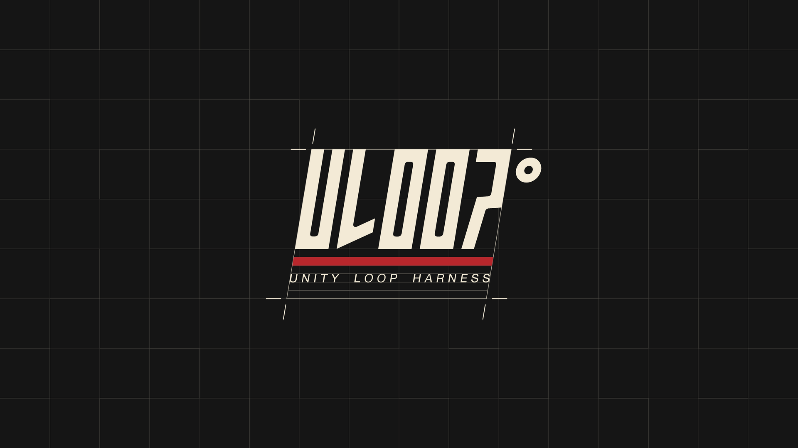
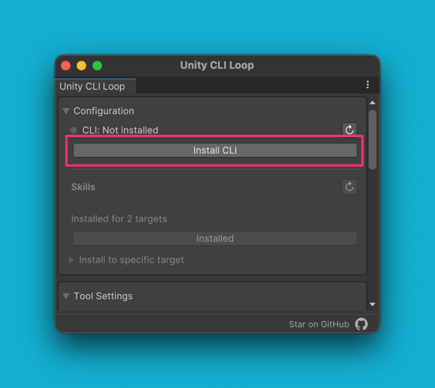
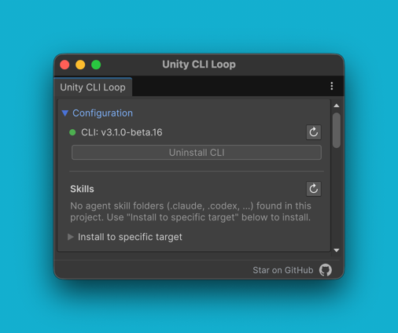
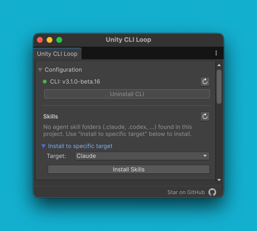

# Unity CLI Loop

[English](README.md) | [日本語](README_ja.md) | Türkçe

[](https://unity3d.com/)
[](LICENSE.md)<br>


![Codex](https://img.shields.io/badge/Codex-111?logo=)


<p align="center">
    <br>
    <sub>(Logo, Daft Punk'ın <i>Human After All</i> albüm kapağından esinlenmiştir)</sub>  
</p>
  

Bir yapay zekâ ajanının, popüler LLM araçlarından CLI aracılığıyla Unity projenizi derlemesine, test etmesine ve yönetmesine olanak tanıyın.

Mevcut Unity projeleriniz içinde yapay zekâ odaklı geliştirme döngülerini otonom olarak sürdürmek için tasarlanmıştır.

> [!IMPORTANT]
> - **[V3'teki Yenilikler](Packages/src/Documentation~/whats-new-v3.md)** — artık Node.js kurulumu veya port yönetimi yok; yeni `hot-reload` / `pause-point` araçları, proje bazlı sürüm seçimiyle otomatik CLI güncellemeleri ve iyileştirilmiş bağlantı kararlılığı
> - **[Özel Araçları ve Becerileri V3'e Taşıma](Packages/src/Documentation~/migration-v2-to-v3.md)** — C# özel araçları veya `uloop` komutunu çağıran beceriler ve betikler yazmış olanlar için. Diğer herkes yalnızca paketi ve CLI'ı güncelleyerek geçiş yapabilir

# Konsept
Unity CLI Loop, **yapay zekânın en az insan müdahalesiyle Unity projenizi ileriye taşıyabilmesi** için tasarlanmış bir Unity entegrasyon aracıdır.
İnsanların genellikle elle yaptığı görevler — derleme, Test Runner çalıştırma, günlükleri inceleme, sahneleri düzenleme, arayüz yerleşimini doğrulamak için pencerelerin ekran görüntüsünü alma ve hatta yeni eklenen bir özelliği gerçekten çalıştığını doğrulamak için kullanma — tamamen LLM araçlarından yürütülebilir.

Unity CLI Loop dört temel fikir üzerine kuruludur:

1. **Yapay zekânın otonom olarak derlediği, test ettiği, günlükleri incelediği ve sorunları çözdüğü kendi kendine yeten bir geliştirme döngüsü** — kodu düzenlemeden herhangi bir kaynak satırında yürütmeyi duraklatabilir ve bir hatanın nedenini bulmak için o andaki değişkenleri okuyabilir. Metot gövdesi düzeltmeleri yeniden derleme beklemeden çalışan oyuna anında uygulanabilir. `compile`, `run-tests`, `get-logs`, `clear-console`, `pause-point`, `hot-reload` araçlarını kullanır.
2. **Yapay zekâ destekli Unity Editor yönetimi — ekran görüntülerinden sahne kurma, nesne düzenleme, menü çalıştırma ve arayüz iyileştirme.** `execute-dynamic-code`, `screenshot` araçlarını kullanır.
3. **PlayMode otomatik testi — yapay zekâ düğmelere tıklar, öğeleri sürükler, tuşlara basar, kaydedilmiş girdileri yeniden oynatır ve oyun davranışını doğrular.** `simulate-mouse-ui`, `simulate-mouse-input`, `simulate-keyboard`, `replay-input`, `execute-dynamic-code`, `screenshot` araçlarını kullanır.
4. **Tüm bunları en az sayıda araçla başarmak.** Bkz. [Tasarım Felsefesi](#tasarım-felsefesi).

# Demolar

Her klip, `uloop` aracılığıyla küçük bir voksel oyununu yöneten gerçek bir Claude Code oturumudur. Yalnızca terminalin değiştiği bölümler hızlandırılmıştır; oyun gerçek hızında çalışır.

## Unity'yi başlatma: `launch`

`uloop launch` projeyi belirttiği Unity sürümünde açar ve Editör komut almaya hazır olduğunda döner.

https://github.com/user-attachments/assets/9e1edafe-07e6-4439-862f-4bbe6ff86f0f

## Özellik ekleme ve test etme: `compile`, `run-tests`

Claude parlayan bir meşale bloğu ekler, projeyi `compile` ile derler ve `run-tests` ile EditMode testlerini çalıştırır. Başarısız olan testi düzeltir, ardından Play Mode'da gece vakti meşaleyi kontrol eder.

https://github.com/user-attachments/assets/98bba49f-1846-4b8e-9702-733207e8318f

## Play Mode sırasında kodu değiştirme: `hot-reload`

Claude çift zıplama ekler ve Play Mode'dan çıkmadan `hot-reload` ile uygular, ardından zıplama yüksekliklerini ölçmek için `simulate-keyboard` ile Boşluk tuşuna basar.

https://github.com/user-attachments/assets/fdba761a-b65a-4297-92f1-5cb274f4c4cf

## Bir satırda durma ve o kareyi okuma: `pause-point`

Su bir boşluğa ilk kez aktığında, `pause-point` bir hücrenin yeni su seviyesine karar veren satırda oyunu durdurur ve o karenin yerel değişkenlerini, alanlarını ve çağrı yolunu döndürür. Ardından bir izleme ifadesi, su her adımda bir tik ilerlerken kanal boyunca su seviyesini takip eder.

https://github.com/user-attachments/assets/99ef7b4a-b32f-4e75-9aa8-9e976f7b0078

## Oyun içinde C# çalıştırma: `execute-dynamic-code`

`execute-dynamic-code` çalışan oyunun içinde C# kodu yürütür. Claude oyuncunun önüne on cam blok dizer, ardından geçici bir kameradan kulenin geniş açılı görüntüsünü alır.

https://github.com/user-attachments/assets/804d81bc-e019-4423-bfcd-089cd0e207c2

## Oyunun gösterdiğini yakalama: `screenshot`

Claude `execute-dynamic-code` ile gölü bulur, kamerayı gölün yukarısına taşır ve `screenshot` ile görüntüyü yakalar, ardından HUD'ı gizleyip tekrar çekim yapar.

https://github.com/user-attachments/assets/da9302a6-7785-4b21-affa-e6f814094c48

## Sahneyi okuma: `get-hierarchy`, `find-game-objects`

`get-hierarchy` çalışan sahnenin ağacını bir dosyaya kaydeder ve `find-game-objects` Player nesnesinin bileşenlerini okur.

https://github.com/user-attachments/assets/ccb960a9-fa8a-40d8-b72c-7e24e11d32c8

## Tuşlara basma: `simulate-keyboard`

`simulate-keyboard` Input System üzerinden W tuşunu basılı tutar. Oyuncu kıyıdan göle yürür ve bir ekran görüntüsü su altı görünümünü doğrular.

https://github.com/user-attachments/assets/7b7abb7c-6d87-464e-b7d7-223109c27d30

## Fareyi hareket ettirme ve tıklama: `simulate-mouse-input`

`simulate-mouse-input` üç bloğu kırıp çukuru suyla doldurmak için fareyi tıpkı bir el gibi kademeli olarak hareket ettirir.

https://github.com/user-attachments/assets/0ecf0876-8230-4b4d-b51a-fe72cf9ca4c7

# Hızlı Başlangıç

Bu kılavuz, LLM aracınızın Unity'yi yönetebilmesi için üç bileşeni — CLI, Unity paketi ve beceriler (skills) — kurar. Her şeyi terminalden veya Unity arayüzünden kurabilirsiniz; iki yol da tek başına eksiksizdir.

## Başlamadan önce

Şunlara sahip olduğunuzdan emin olun:

- Unity 2022.3 veya daha yeni bir sürümde çalışan bir Unity projesi
- Claude Code veya Codex gibi beceri yükleyebilen bir LLM aracı

> [!NOTE]
> **V2'den yükseltme**: Projede V2 API'sine göre yazılmış özel araçlar varsa, V3 paketi kurulduktan hemen sonra derleme hataları görünür. Bu beklenen bir durumdur. Bunları elle düzeltmeyin: açılışta Unity'nin Safe Mode isteminde `Ignore` seçeneğini seçin, ardından otomatik açılan geçiş penceresinde (`Window > Unity CLI Loop > Custom Tool Migration`) **Migrate** düğmesine basın. Tam prosedür için [Özel Araçları ve Becerileri V3'e Taşıma](Packages/src/Documentation~/migration-v2-to-v3.md) belgesine bakın.

> [!NOTE]
> **macOS izin istemleri**: Unity yanıt vermediğinde `uloop status` onu engelleyen bir iletişim kutusu olup olmadığına bakar; `uloop get-dialogs` / `uloop press-dialog-button` ise bu pencereyi okuyup düğmesine basar. İlk seferde macOS, `uloop` çalıştıran uygulamanın (terminaliniz veya LLM aracınız) System Events'i kontrol edip Erişilebilirlik (Accessibility) kullanıp kullanamayacağını sorar. Sistem Ayarları > Gizlilik ve Güvenlik (Otomasyon ve Erişilebilirlik) altından ikisine de izin verin. Bunlar olmadan `uloop` yine çalışır ancak iletişim kutularını bildiremez veya kapatamaz ve bir istem yanıt beklerken `uloop status` yaklaşık 5 saniye daha uzun sürebilir.

## Terminalden kurulum

### Adım 1: CLI'ı kurun

**macOS, Linux (x86_64), Windows Git Bash:**

Linux üzerinde `focus-window` desteklenmez.

```sh
curl -fsSL https://raw.githubusercontent.com/hatayama/unity-cli-loop/main/scripts/install.sh | sh
```

**Windows PowerShell:**

```powershell
irm https://raw.githubusercontent.com/hatayama/unity-cli-loop/main/scripts/install.ps1 | iex
```

**Homebrew (macOS):**

```bash
brew install hatayama/tap/uloop
```

Kurulumun başarılı olduğunu doğrulayın:

```bash
uloop -v
```

İlk satırda CLI sürümü (örneğin `3.0.1`) göründüğünde kurulum tamamlanmıştır.

<details>
<summary>Otomatik CLI güncellemeleri</summary>

Siz kullanırken CLI günde en fazla bir kez daha yeni bir sürüm olup olmadığını kontrol eder ve kurar; yeni sürüm bir sonraki komuttan itibaren geçerli olur.

- Tek sürümde kalmak için: `uloop update --to-version <version>` o sürümü kurar ve sabitler. Otomatik güncellemelere dönmek için `uloop update` çalıştırın.
- Otomatik güncellemeleri kapatmak için: ortam değişkeni olarak `ULOOP_DISABLE_SELF_UPDATE=1` ayarlayın.
- Homebrew kurulumları kendilerini güncellemez; `brew upgrade uloop` (ve sürüm sabitlemek için `brew pin uloop`) kullanın.

</details>

### Adım 2: Unity paketini kurun

Bunu Unity projenizin kök dizininde çalıştırın:

```bash
uloop package install
```

Bu komut `Packages/manifest.json` dosyasına OpenUPM kapsamlı kayıt defterini ve `io.github.hatayama.uloopmcp` bağımlılığını ekler. Belirli bir sürümü sabitlemek için `--version <x.y.z>` ekleyin.

Ardından Unity'yi başlatın. Unity zaten açıksa bu komut o pencereyi öne getirir:

```bash
uloop launch
```

Unity açıldığında paket projeye kurulmuş olur. Bir sonraki adım becerileri kurulu paketten okur.

### Adım 3: Becerileri (Skills) kurun

Unity projenizin kök dizininde LLM aracınız için uygun komutu çalıştırın:

```bash
# Claude Code
uloop skills install --claude

# Codex ve .agents/skills okuyan diğer araçlar
uloop skills install --agents

# Unity projesini içeren Git deposunun köküne kurulum
uloop skills install --claude --root git

# Proje yerine genel (global) kurulum
uloop skills install --claude --global

# Herhangi bir dizine eşitleme (ör. harici bir beceri deposu)
uloop skills install --output-dir path/to/skills
```

## Unity arayüzünden kurulum

### Adım 1: Unity paketini kurun

`Window > Package Manager` içinde "+" düğmesine basın, **Add package from git URL** seçeneğini seçin ve şunu girin:

```text
https://github.com/hatayama/unity-cli-loop.git?path=/Packages/src
```

<details>
<summary>OpenUPM kapsamlı kayıt defterinden kurulum</summary>

1. `Project Settings > Package Manager` içinde Scoped Registries bölümüne şu girdiyi ekleyin:
```text
Name: OpenUPM
URL: https://package.openupm.com
Scope(s): io.github.hatayama.uloopmcp
```
2. `Window > Package Manager` içinde My Registries altından OpenUPM'yi seçin ve Unity CLI Loop paketini kurun.

</details>

### Adım 2: CLI'ı kurun

`Window > Unity CLI Loop > Settings` penceresini açın ve **Install CLI** düğmesine basın:



CLI sürümü göründüğünde ve düğme **Uninstall CLI** olarak değiştiğinde işlem tamamlanmıştır:



### Adım 3: Becerileri kurun

Aynı Settings penceresinde hedefinizi seçin — örneğin **Claude Code**, ya da Codex ve `.agents/skills` okuyan diğer araçlar için **Common (.agents)** — ve **Install Skills** düğmesine basın:



<details>
<summary>V2 projeleriyle birlikte çalışma</summary>

V2 paketindeki projeler ile V3 projeleri aynı makinede bir arada bulunabilir. V3 CLI kurulu kalsın: bir V2 projesinde `uloop` komutu otomatik olarak V2 CLI'ı kullanır (ilk kullanımda indirilir; Node.js 22 veya üzeri gerekir).

V2 projesinin Settings penceresinde **Update CLI** veya **Downgrade CLI** düğmelerine basmayın ve `npm install -g uloop-cli` ile V2 CLI'ı yeniden kurmayın. Eski npm `uloop` aracı V3 CLI'ı gölgeler. Bu zaten olduysa `npm uninstall -g uloop-cli` çalıştırın, ardından "Terminalden kurulum" Adım 1'deki CLI yükleyicisini yeniden çalıştırın veya Settings penceresinde **Install CLI** düğmesine basın.

</details>

Hepsi bu kadar! Becerileri kurduktan sonra LLM araçları aşağıdaki gibi talimatları otomatik olarak yerine getirebilir:

| Talimatınız | LLM Araçlarının Kullandığı Beceri |
|---|---|
| "Bu proje için Unity'yi başlat" | `/uloop-launch` |
| "Derleme hatalarını düzelt" | `/uloop-compile` |
| "Bu düzeltmeyi derlemeden hemen uygula" | `/uloop-hot-reload` |
| "Testleri çalıştır ve neden başarısız olduklarını söyle" | `/uloop-run-tests` + `/uloop-get-logs` |
| "Sahne hiyerarşisini kontrol et" | `/uloop-get-hierarchy` |
| "Oyunu oynat ve Unity'yi öne getir" | `/uloop-control-play-mode` + `/uloop-focus-window` |
| "Prefab parametrelerini topluca güncelle" | `/uloop-execute-dynamic-code` |
| "Game View ekran görüntüsü al ve arayüz yerleşimini ayarla" | `/uloop-screenshot` + `/uloop-execute-dynamic-code` |
| "Kaydedilmiş girdiyi yeniden oynat" | `/uloop-replay-input` |
| "Bu satırda duraklat ve hatayı incele" | `/uloop-pause-point` |


<details>
<summary>Dahili 21 Becerinin Tamamı</summary>

- `/uloop-launch` - Unity'yi doğru sürümle başlat
- `/uloop-status` - Unity'nin şu an komut alıp alamayacağını kontrol et ve BUSY komutları reddetmeye devam ettiğinde çalışan komutu iptal et
- `/uloop-compile` - Derlemeyi çalıştır
- `/uloop-get-logs` - Konsol günlüklerini al
- `/uloop-run-tests` - Testleri çalıştır
- `/uloop-hot-reload` - Metot gövdesi değişikliklerini yeniden derlemeden çalışan koda anında uygula
- `/uloop-clear-console` - Konsolu temizle
- `/uloop-focus-window` - Unity Editor penceresini öne getir
- `/uloop-get-hierarchy` - Sahne hiyerarşisini al
- `/uloop-find-game-objects` - GameObject'leri bul
- `/uloop-screenshot` - EditorWindow ekran görüntüsü yakala
- `/uloop-pause-point` - Herhangi bir satırda yürütmeyi duraklat ve değişkenleri yakala
- `/uloop-set-game-view-size` - Game View özel çözünürlüğünü oku ve ayarla
- `/uloop-game-view-mode` - Game view sekmesini Game view ile Device Simulator arasında göster/değiştir, yönelimini eşleştir veya simüle edilen cihazı seç
- `/uloop-record-video` - Game View veya bir Editor penceresini kaydet ve bir ajanın okuyabileceği kare panoları ile değişim sayılarını al; tek komut bir eylem etrafında kayıt yapabilir
- `/uloop-simulate-mouse-ui` - PlayMode arayüz öğelerinde fare tıklama, uzun basma ve sürükleme simüle et
- `/uloop-simulate-mouse-input` - Input System aracılığıyla PlayMode'da fare girdisi simüle et
- `/uloop-simulate-keyboard` - Input System aracılığıyla PlayMode'da klavye girdisi simüle et
- `/uloop-replay-input` - PlayMode sırasında Recordings penceresinde kaydedilen girdiyi yeniden oynat
- `/uloop-control-play-mode` - Play Mode'u kontrol et
- `/uloop-execute-dynamic-code` - Dinamik C# kodu çalıştır

</details>

<details>
<summary>Doğrudan CLI Kullanımı (İleri Düzey)</summary>

Becerileri kullanmadan CLI'ı doğrudan da çağırabilirsiniz:

```bash
# Kullanılabilir araçları listele
uloop list

# Unity projesini doğru sürümle başlat
uloop launch

# Belirli bir derleme hedefiyle başlat (Android, iOS, StandaloneOSX vb.)
uloop launch -p Android

# Çalışan Unity'yi kapat ve yeniden başlat
uloop launch -r

# Derlemeyi çalıştır
uloop compile

# Domain Reload beklemeden derle
uloop compile --no-wait-for-domain-reload

# Değişen .cs dosyalarının metot gövdelerini yeniden derlemeden çalışan koda uygula
uloop hot-reload

# Günlükleri al
uloop get-logs --max-count 10

# Testleri çalıştır
uloop run-tests --filter-type all

# Dinamik kod çalıştır
uloop execute-dynamic-code --code 'using UnityEngine; Debug.Log("Hello from CLI!");'
```

</details>

## Claude Code için Yapılandırma

Claude Code kabuk komutlarını bir korumalı alan (sandbox) içinde çalıştırır ve sandbox varsayılan olarak ağ erişimini engeller. Unity ile kurulan IPC bağlantısı da bundan etkilenir; dolayısıyla Unity sorunsuz çalışıyor olsa bile `uloop` bağlanmaya çalıştığı anda `UNITY_NOT_REACHABLE` (`connect: operation not permitted`) hatasıyla başarısız olur.

`uloop` komutlarını sandbox dışında bırakmak için `~/.claude/settings.json` dosyasında `sandbox.excludedCommands` içine `uloop *` ekleyin:

```json
{
  "sandbox": {
    "excludedCommands": ["uloop *"]
  }
}
```

Desen **yazıldığı hâliyle komut dizesiyle** eşleştirilir; bu nedenle `uloop` ile başlayan çağrılar hariç tutulur. Ayrıntılar ve ölçüm sonuçları için [docs/claude-code-sandbox.md](docs/claude-code-sandbox.md) belgesine bakın.

# Nasıl Çalışır?

Bir `uloop` komutu Unity Editor'e şu zincir üzerinden ulaşır:

- **Genel `uloop` dağıtıcısı (dispatcher)** — PATH üzerindeki tek giriş noktası. Komutu yorumlar ve hedef projenin çalıştırıcısına iletir
- **`uloop-project-runner`** — proje bazlı çalıştırıcı. Kullanılacak sürüm her projenin `.uloop/project-runner-pin.json` (pin) dosyasıyla belirlenir ve sürüm bazlı kullanıcı önbelleğine otomatik indirilir; farklı sürümlerdeki birden fazla proje aynı makinede bu sayede bir arada çalışır → [proje çalıştırıcı pin ayrıntıları](docs/project-runner-pin.md)
- **Unity Editor içindeki IPC sunucusu** — çalıştırıcıdan gelen bağlantıları kabul eder, Unity API'lerini yürütür ve sonuçları döndürür

Bağlantı **hiçbir TCP portu kullanmaz**. macOS/Linux'ta Unix domain socket, Windows'ta ise named pipe üzerinden çalışır; bu nedenle yapılandırılacak port yoktur ve diğer Editör örnekleriyle port çakışması yaşanmaz.

# Tasarım Felsefesi

Unity CLI Loop araç sayısını şişirme peşinde değildir. Dinamik C# kodu yürütme (`execute-dynamic-code`) ile neredeyse her Unity Editor işlemi tek bir araçla yapılabilir.

Çok fazla araç, yapay zekânın doğru aracı seçmesini zorlaştırır. Araçlar Beceri olarak paketlense bile her aracın açıklaması bağlam penceresinden yer. Araç sayısını temel asgari düzeyde tutmanın iyi bir tasarım olduğuna inanıyoruz.

Özel araçlar yalnızca dinamik kod yürütmenin doğası gereği karşılayamadığı işlemler (kareler arası girdi simülasyonu ve ekran görüntüsü yakalama gibi) ve geliştirme döngüsünde her seferinde C# kodu üretmenin token israfı olacağı kadar sık çağrılan işlemler (`compile` ve `get-logs` gibi) için vardır.

Yeni bir özel araca ihtiyaç duyduğunuzda genellikle bir Beceri yeterli olur. Rutin işlemi SKILL.md talimatları, bir kabuk betiği veya `execute-dynamic-code` aracına verilen bir C# parçası olarak yazın; yapay zekâ onu doğrudan çağırır. Beceri gövdesi yalnızca başlangıçta yüklenir ve her çalıştırmada yeniden üretilmesi gerekmez, bu nedenle ek token maliyeti sıfıra yakındır. Nasıl oluşturacağınızı öğrenmek için [Özel Araç Geliştirme Kılavuzu](Packages/src/Documentation~/custom-tools.md#custom-skills-for-your-tools) belgesine bakın.

# Temel Özellikler

Her aracın ayrıntılı açıklamaları ve kullanım örnekleri için **[Araç Referansı](Packages/src/Documentation~/tools.md)** belgesine bakın.

## Geliştirme Döngüsü Araçları
- `compile` - Derlemeyi çalıştırır ve hatalar ile uyarıları döndürür
- `get-logs` - Konsoldakiyle aynı günlükleri tür veya arama dizesine göre filtreleyerek getirir
- `run-tests` - Unity Test Runner'ı (PlayMode / EditMode) çalıştırır
- `hot-reload` - Metot gövdesi değişikliklerini yeniden derlemeden çalışan koda anında uygular
- `pause-point` - Kodu düzenlemeden PlayMode'u herhangi bir satırda duraklatır ve o andaki değişkenleri okur

## Unity Editor Otomasyon ve Keşif Araçları
- `clear-console` - Konsol günlüklerini temizler
- `find-game-objects` - Sahne nesnelerini arar ve bileşenlerini inceler
- `get-hierarchy` - Sahne yapısını JSON olarak getirir
- `focus-window` - Unity Editor penceresini öne getirir
- `screenshot` - EditorWindow veya Game View ekran görüntülerini kaydeder
- `set-game-view-size` - Game View özel çözünürlüğünü okur ve ayarlar
- `game-view-mode` - Game view sekmesini Game view ile Device Simulator arasında gösterir/değiştirir, yönelimini eşleştirir veya simüle edilen cihazı seçer
- `record-video` - Game View veya bir Editor penceresini MP4 (Linux'ta WebM) olarak kaydeder ve kare panoları ile kare başına değişim sayılarını döndürür; ffmpeg ile sonradan kareler kesilebilir
- `control-play-mode` - Play Mode'u başlatır, durdurur ve duraklatır
- `execute-dynamic-code` - Dinamik C# kodu çalıştırır

## PlayMode Otomatik Test Araçları
- `simulate-mouse-ui` - Arayüz öğelerinde fare işlemlerini simüle eder (EventSystem üzerinden)
- `simulate-mouse-input` - Input System aracılığıyla fare girdisini simüle eder
- `simulate-keyboard` - Input System aracılığıyla klavye girdisini simüle eder
- `replay-input` - PlayMode sırasında Recordings penceresinde kaydedilen girdiyi yeniden oynatır

## Unity CLI Loop Uzantı Geliştirme

Çekirdek pakete dokunmadan tür güvenli biçimde projeye özel araçlar ekleyin. Aracınızın yanında bir `Skill/SKILL.md` sunun; yapay zekâ ajanları bunu otomatik olarak keşfeder.

Uygulama adımları ve Beceri yazımı için **[Özel Araç Geliştirme Kılavuzu](Packages/src/Documentation~/custom-tools.md)** belgesine bakın.

## Diğer

### Unity CLI Loop Dosyaları

`UserSettings/UnityCliLoopSettings.json` kullanıcı bazlı editör ayarlarını saklar ve her zaman yalnızca yerelde kalmalıdır.

Proje kökündeki `.uloop/` dizini CLI önbelleğini, araç kayıt defterini ve çalışma zamanı çıktılarını saklar. İçeriğinin çoğu yalnızca yereldir, ancak bazı dosyalar ekip paylaşımı için isteğe bağlı olarak Git ile izlenebilir.

| Dosya | Amaç | Git ile izlensin mi? |
|------|---------|------------|
| `project-runner-pin.json` | Genel dağıtıcının kullandığı proje çalıştırıcı sürüm sözleşmesi | İsteğe bağlı |
| `settings.tools.json` | Araç bazlı etkinleştirme/devre dışı bırakma tercihleri | İsteğe bağlı |
| `settings.skills.json` | Beceri kurulum konumu (Unity proje kökü veya Git depo kökü) | İsteğe bağlı |
| `tools.json` | Otomatik oluşturulan CLI araç kayıt defteri | Hayır |
| `outputs/` | Çalışma zamanı çıktıları (test sonuçları, ekran görüntüleri, hiyerarşi dökümleri) | Hayır |

> [!TIP]
> **Önerilen `.gitignore` deseni**
>
> ```gitignore
> **/.uloop/*
> !**/.uloop/settings.tools.json
> !**/.uloop/settings.skills.json
> ```
>
> Bu desen otomatik oluşturulan dosyaları ve çalışma zamanı çıktılarını yok sayarken ekipçe paylaşılan yapılandırmaların izlenmesine izin verir.
> Paylaşmanız gerekmeyen bir ayar (araç etkinleştirme tercihleri veya beceri kurulum konumu) için ilgili `!` satırını kaldırın.
>
> `project-runner-pin.json` dosyasının izlenmesi gerekmez: Editör projeyi her açtığında bunu yeniden yazar ve `uloop` kurulu paketin içindeki pine geri döner. Bunu (`!**/.uloop/project-runner-pin.json` ekleyerek) yalnızca CI gibi Unity'de hiç açılmamış yeni bir klonda sabitlenmiş çalıştırıcıyı kullanan `uloop` komutları çalıştırıyorsanız izleyin.

## Lisans
MIT Lisansı
